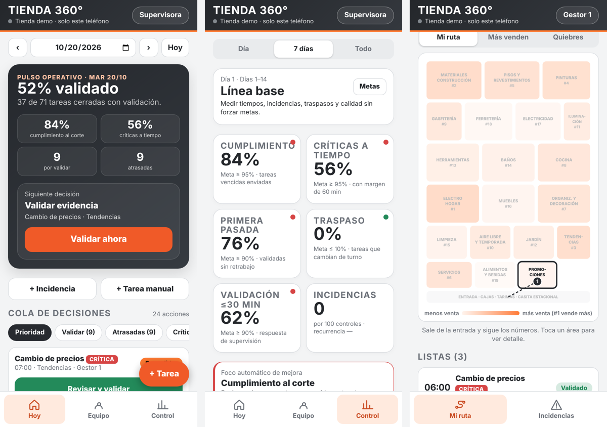
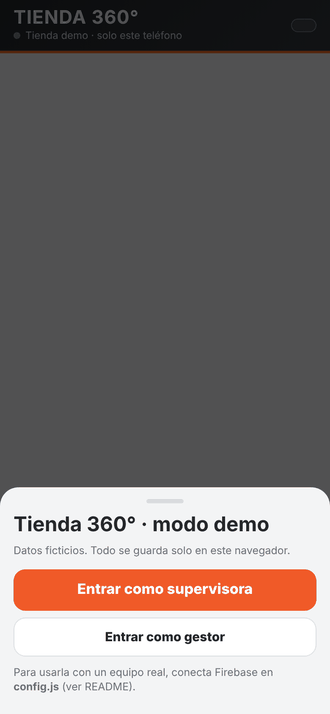
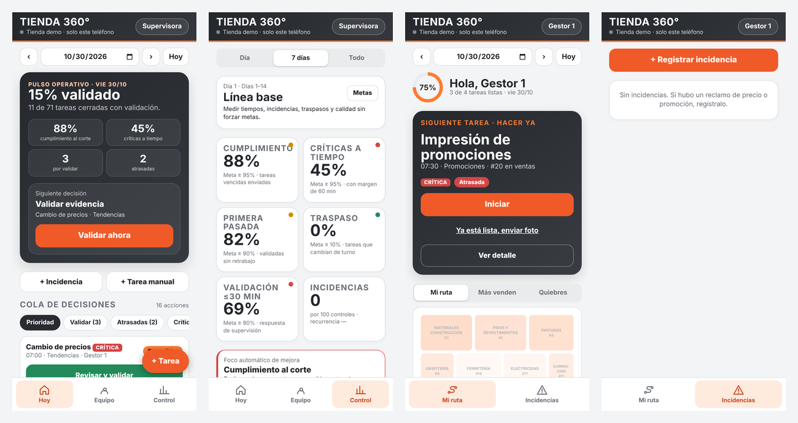

# Tienda 360° · App de gestión del equipo de piso (PWA)

> **EN —** A mobile web app (PWA) for a retail store's floor team: a supervisor and the floor staff. It builds a daily task plan balanced by workload and prioritized by each area's sales and stock-outs. It tracks execution with photo evidence and supervisor validation, and measures six operational KPIs inside a DMAIC improvement plan. Staff never see sales amounts, which is enforced by Firestore security rules. It works offline-first and syncs live through Firebase. **It includes a demo mode with fictitious data that runs without any setup.**

## Demo y capturas

Recorrido por la app en modo demo (datos ficticios): pulso del día, cola de decisiones, KPI del plan DMAIC, mapa de ruta del gestor e incidencias.

Puedes probarla ahora mismo en <https://rosyisabelnapuchi.github.io/tienda-360/> (activa GitHub Pages en *Settings → Pages*).

## El problema

En una tienda grande, la supervisora reparte el trabajo de la mañana "de memoria": cambios de precio,
promociones, quiebres de stock, rutinas. Las tareas críticas se atrasan sin que nadie lo note a tiempo,
los pendientes pasan de turno sin dueño y no hay datos para mejorar. Tampoco se sabía si una tarea quedó
bien a la primera.

## Qué hace

| Para la supervisora | Para cada gestor |
|---|---|
| **Genera el plan del día** repartido por **carga relativa**: una merma pesa más que una cabecera | **Siguiente tarea**: lo urgente e importante primero (matriz de Eisenhower) |
| **Siguiente decisión**: validar, corregir, resolver un atraso o asignar responsable | Ruta en el **mapa de la tienda**, ordenada por las áreas que más venden |
| Valida con evidencia fotográfica y un **CHECK de 8 puntos** | Envía foto y la marca como lista para validar |
| **Control**: 6 KPI con metas configurables y foco automático de mejora | Registra incidencias de precio o promoción |
| Ve montos de venta por área | Ve **solo el orden de ventas (#1, #2, …), nunca montos** |

## Indicadores (plan DMAIC)

| KPI | Fórmula | Meta inicial |
|---|---|---|
| Cumplimiento al corte | tareas vencidas enviadas / tareas vencidas | ≥ 95 % |
| Críticas a tiempo | críticas enviadas dentro de la hora + 60 min / críticas vencidas | ≥ 95 % |
| Primera pasada (FPY) | validadas sin corrección / validadas | ≥ 90 % |
| Traspaso entre turnos | tareas que cambian de turno / planificadas | ≤ 10 % |
| Validación ≤ 30 min | evidencias revisadas en ≤ 30 min / revisadas | ≥ 90 % |
| Incidencias por 100 controles | incidencias / controles × 100 | se fija tras la línea base |

Las metas son provisionales. Se recalibran después de 14 días de línea base. El plan 30-60-90, la rutina
diaria de control y las reglas de reacción están en [`PLAN_CONTROL_Y_MEJORA.md`](PLAN_CONTROL_Y_MEJORA.md).

## Decisiones técnicas

- **Un solo archivo HTML**, sin servidor propio: se publica gratis en GitHub Pages y se instala en el celular como una app.
- **Funciona sin conexión**: guarda el estado en el teléfono (localStorage + service worker) y sincroniza con Firestore cuando hay señal, resolviendo conflictos por la última modificación.
- **Privacidad por diseño**: los montos de venta viven en un documento que solo puede leer la cuenta de supervisión. Lo garantizan las reglas de seguridad de `firestore.rules`, no la pantalla.
- **Cuentas individuales**: a una persona se le quita el acceso sin afectar al resto.

## Probar el modo demo

Abre `index.html` publicado (o con cualquier servidor local) y elige **Entrar como supervisora** o
**Entrar como gestor**. El modo demo:
- usa ventas ficticias por área (`demo-data.js`);
- genera el plan del día;
- simula el avance de la jornada (tareas validadas, por validar y atrasadas) para que los indicadores tengan datos.

Todo queda solo en tu navegador.

## Publicarlo en GitHub Pages (sin comandos)

1. Crea un repositorio público `tienda-360` y sube todos los archivos de esta carpeta.
2. **Settings → Pages → Deploy from a branch → main / (root) → Save.**
3. En 1 o 2 minutos aparece el enlace `https://TU-USUARIO.github.io/tienda-360/`, ya en modo demo.

Para usarla con un equipo real (inicio de sesión y datos en vivo), sigue [`GUIA_FIREBASE.md`](GUIA_FIREBASE.md).

## Archivos

| Archivo | Para qué sirve |
|---|---|
| `index.html` | La app completa |
| `config.js` | Datos de Firebase (con `PEGA_AQUI` abre en modo demo) |
| `demo-data.js` / `datos_ventas_demo.json` | Ventas ficticias por área: un archivo para el modo demo y otro de ejemplo del formato de carga |
| `firestore.rules` | Reglas de seguridad: quién lee y escribe cada documento |
| `sw.js`, `manifest.webmanifest`, `icon-*.png` | Instalación como app y funcionamiento sin conexión |

---
**Rosy Napuchi** · Business Intelligence & Data Science · [Portafolio](https://dataross.vercel.app/)
